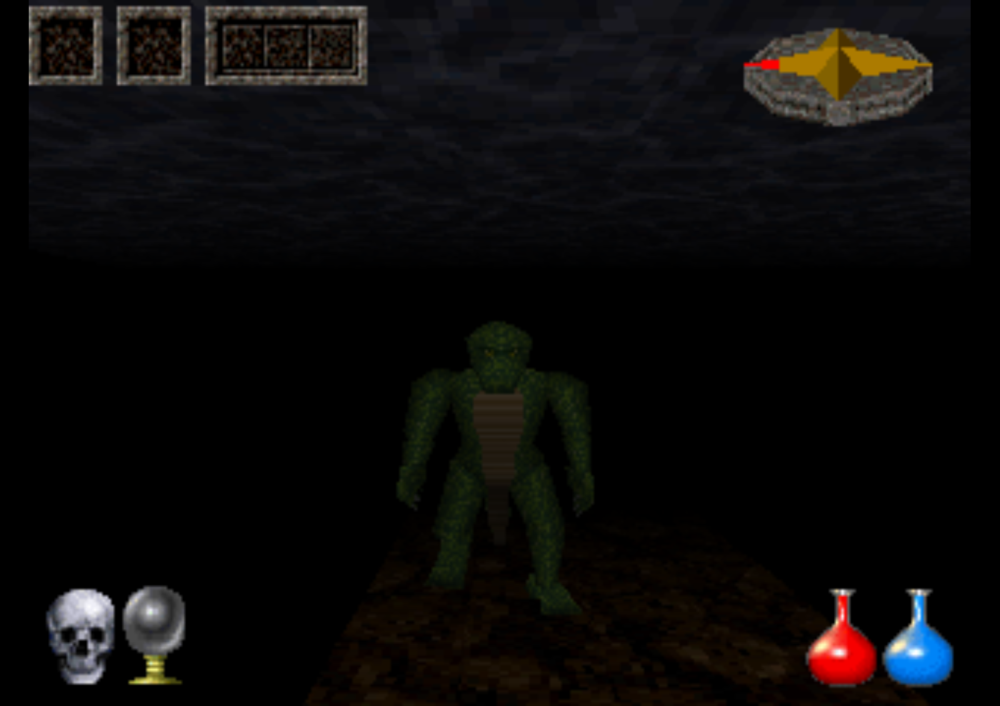
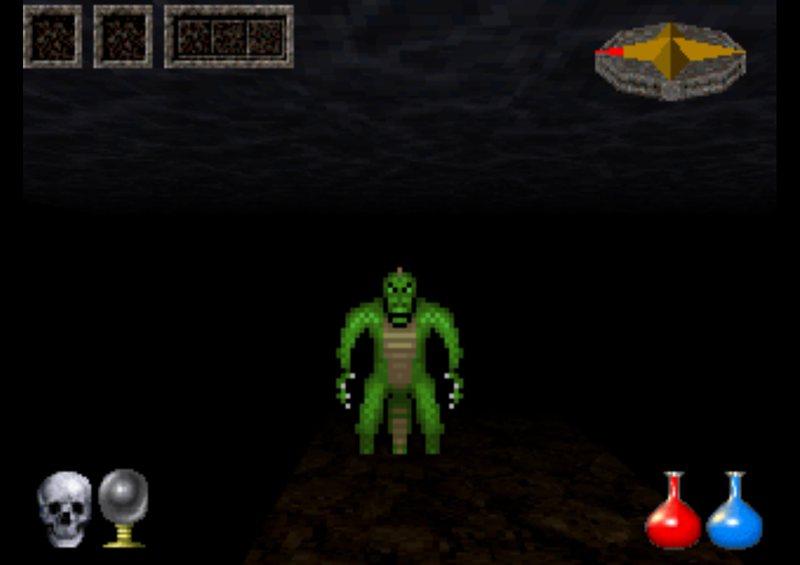
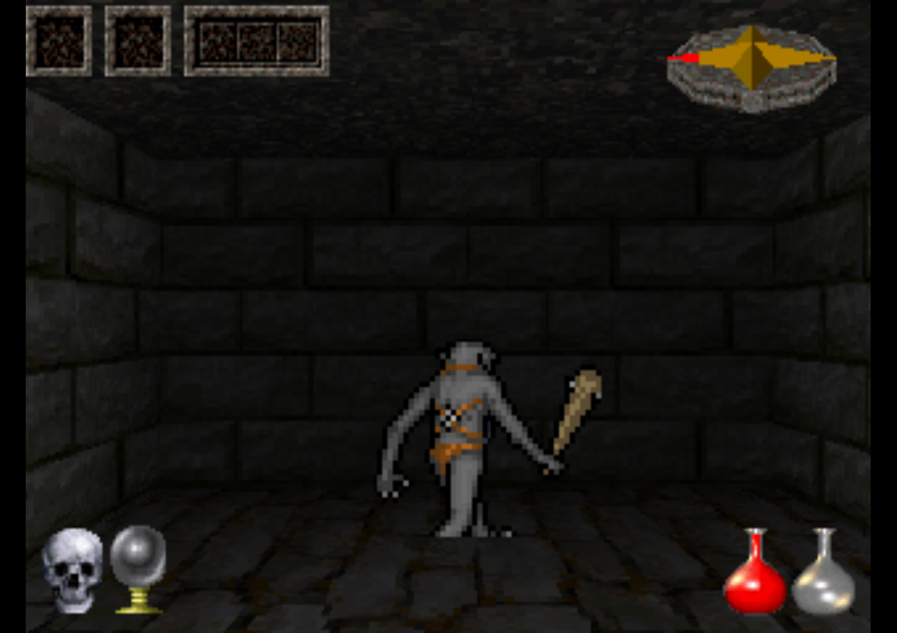
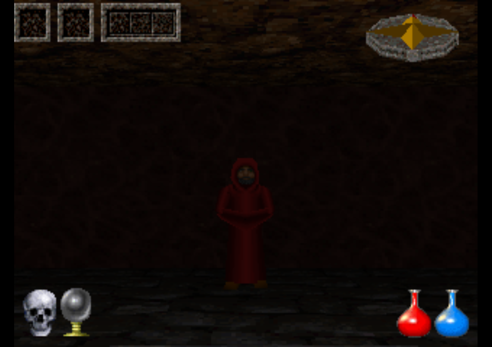
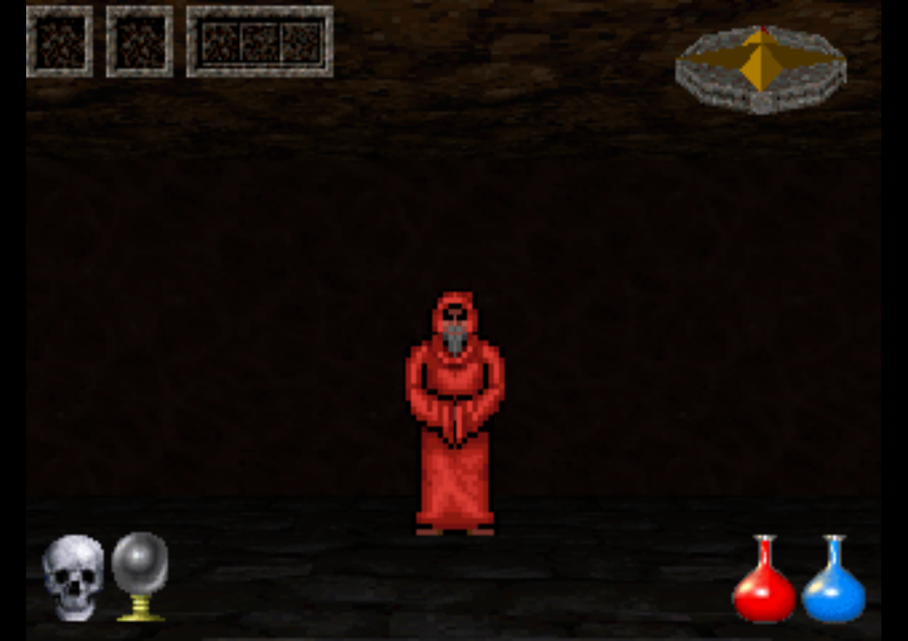
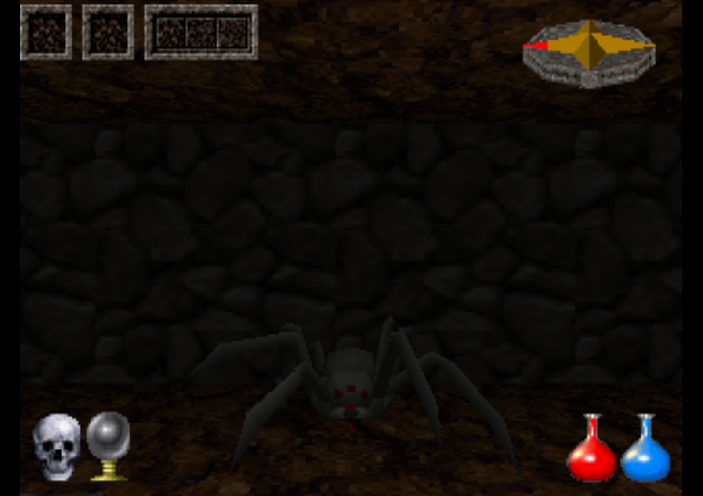
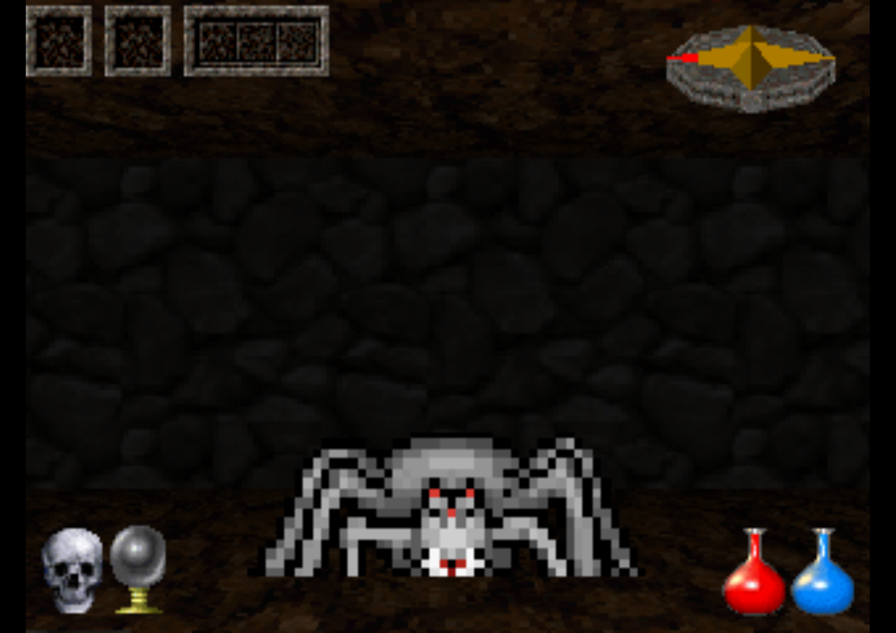
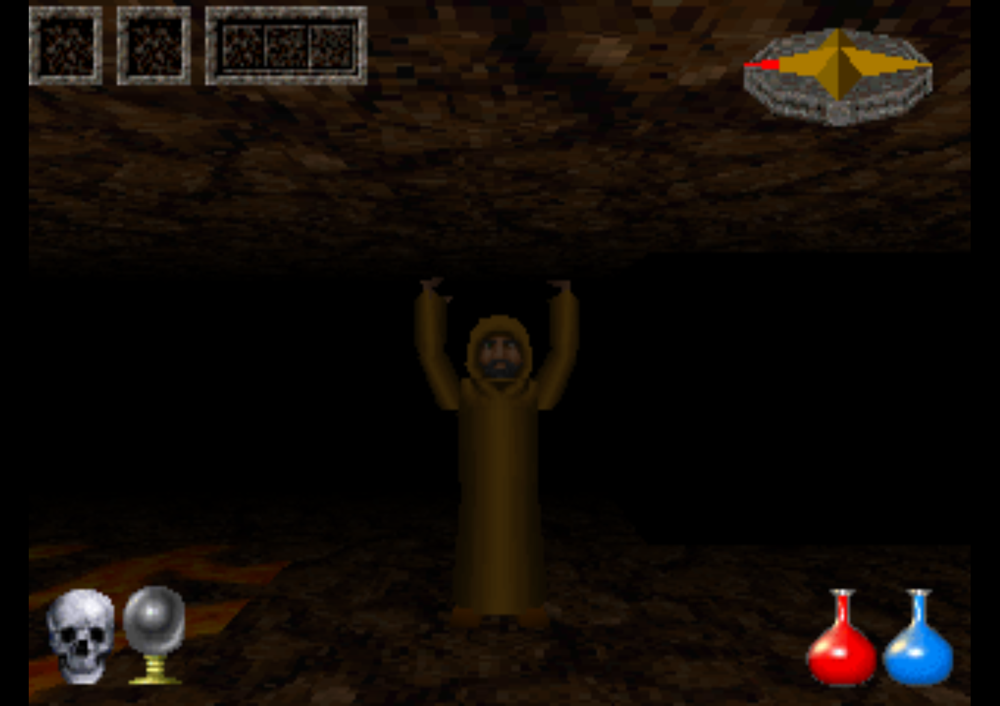
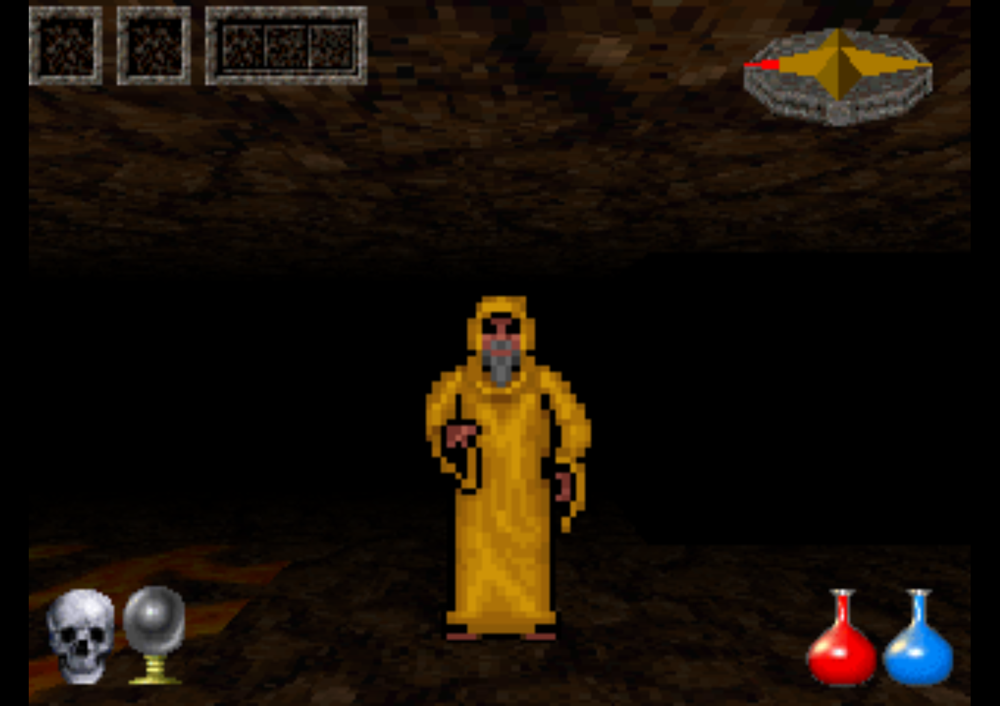

# NPC screenshots

These DuckStation captures show the NPC changes in the PlayStation release. The first two show the same Level 3 actor, camera, and facing with the original model and the DOS sprite.

## Level 3 lizardman, original PlayStation graphics

The original PlayStation renderer draws this Level 3 lizardman as a dark-green textured 3D model. This is the baseline for the matched DOS-sprite view.

## Level 3 lizardman, DOS sprite patch

The patch draws the same actor from the same viewpoint with the DOS sprite. The tan segmented torso, brighter green silhouette, and shape of the feet and tail are visible in the matched view.

## Level 7 goblin, DOS sprite patch

The gray DOS goblin sprite is visible from a rear three-quarter angle in a Level 7 passage. This shows the goblin replacement in use beyond the Level 1 Lanugo test.

## Level 6 wizard, original PlayStation model

The original renderer shows this wizard as a shaded, polygonal red-robed model. The paired capture uses the same actor, camera, and facing.

## Level 6 wizard, DOS sprite preview

The patch shows the same wizard using the original red DOS palette. The sprite preserves the brighter robe, pixel-drawn beard, and folded hands.

## Level 6 spider, original PlayStation model

The original renderer gives this spider a dark polygonal body and long articulated legs. The paired capture uses the same actor, camera, and facing.

## Level 6 spider, DOS sprite preview

The DOS sprite has a lower, broader silhouette with a bright gray body and red markings. It uses the original type 92 DOS palette.

## Level 6 wizard casting, original PlayStation model

The native model raises both arms during the staged cast. The next capture uses the same wizard, camera, and facing with the DOS casting sprites enabled.

## Level 6 wizard casting, DOS sprite preview

The DOS animation uses a smaller hand gesture and the original gold palette. The PlayStation still controls when the spell fires.
